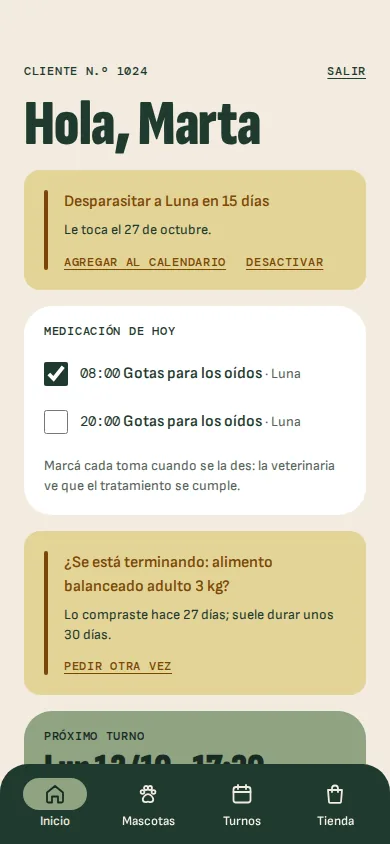
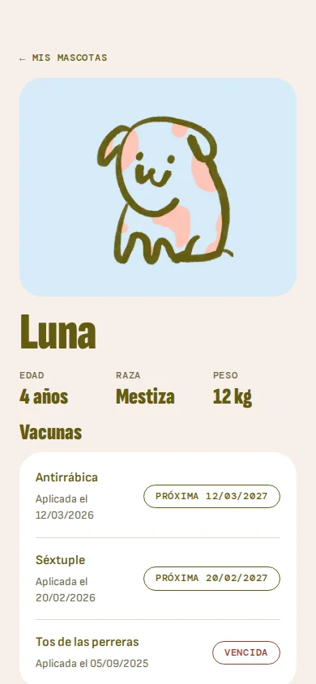
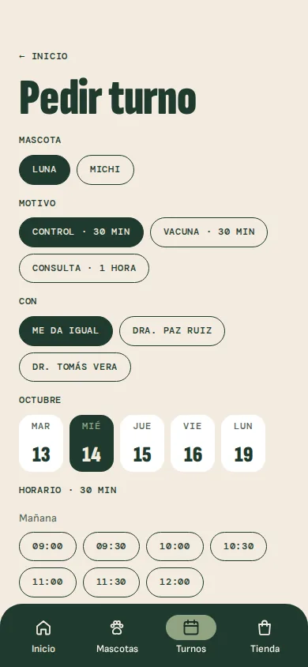
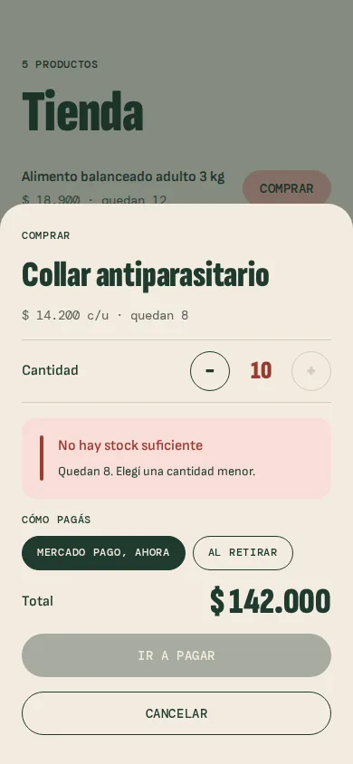
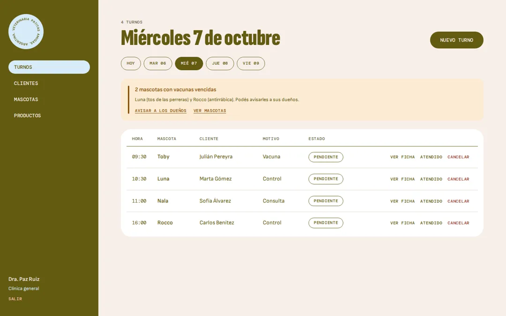
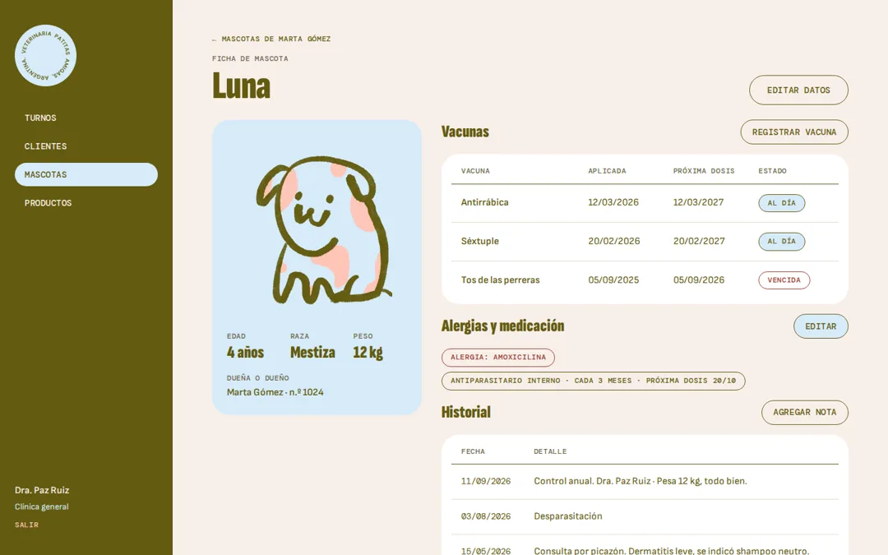
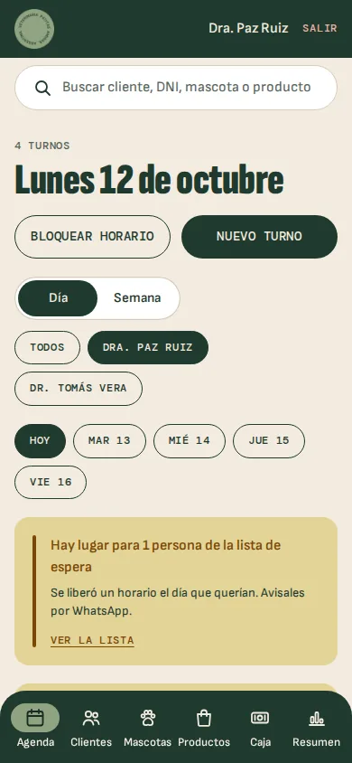

# Veterinaria Patitas amigas

App web para una veterinaria, con dos entradas. Los **clientes**, desde el celular, ven la ficha de cada mascota con sus vacunas, piden turnos, reciben recordatorios y compran productos para retirar en el local. El **equipo de la veterinaria** (veterinarios y recepción), desde la computadora o el celular, maneja la agenda con sala de espera y lista de espera, la atención de cada consulta, la historia clínica, los productos con su stock y la caja del día.

Es un proyecto de portfolio de **Lucía Romeo Gago**. Parte de un trabajo práctico de Programación Orientada a Objetos: un sistema de gestión en PHP que se usaba desde la consola ([repositorio POO](https://github.com/LuciaRomeoGago/POO)). Lo rediseñé en Figma como app web, para celular del lado del cliente y para computadora del lado del veterinario, y lo programé en React.

- Diseño: [Figma](https://www.figma.com/design/npWi8LUuQ9fdjWpDYTM39I/Veterinaria---Patitas-amigas)
- Demo: [veterinaria-patitas-amigas.vercel.app](https://veterinaria-patitas-amigas.vercel.app/)

| Inicio | Ficha de mascota | Pedir turno | Compra sin stock |
| --- | --- | --- | --- |
|  |  |  |  |

| Turnos del día (veterinario) | Ficha e historia clínica (veterinario) | Veterinario en el celular |
| --- | --- | --- |
|  |  |  |

## Para probar la demo

- **Cliente:** número **1024** (tiene dos mascotas, turnos y compras) o **1028** (sin mascotas, para ver los estados vacíos).
- **Veterinaria:** número **7** (Dra. Paz Ruiz) u **8** (Dr. Tomás Vera), y **9** (Ana Sosa, recepción: no ve la historia clínica completa ni el resumen).

Los dos lados comparten los datos: si el veterinario registra una vacuna con aviso, al cliente le aparece en Recordatorios; si el cliente pide un turno, aparece en la agenda; si el cliente marca una toma de la medicación, el veterinario lo ve en la historia clínica.

## Del sistema de consola a la app

Cada opción de los menús del código original tiene su pantalla:

| Menú en PHP | En la app |
| --- | --- |
| Ingresar como cliente (por ID) | Ingreso con número de cliente, con aviso si no existe |
| Administre sus mascotas: agregar, eliminar, modificar | Mis mascotas, ficha, agregar, editar y eliminar con confirmación |
| Mostrar todas sus mascotas | Mis mascotas |
| Comprar productos | Tienda, con control de stock |
| Mostrar inventario | Mis compras |
| Ingresar como veterinario (por ID) | Ingreso de veterinarios |
| Administrar clientes: agregar, eliminar, modificar, mostrar | Clientes, con buscador, panel para agregar o editar y confirmación al eliminar |
| Administrar mascotas de un cliente | Mascotas (se elige el cliente) y ficha de cada mascota |
| Administrar productos: agregar, eliminar, actualizar, mostrar | Productos |

Y se suma lo que el sistema no tenía:

- **Agenda:** una por veterinario, de a 30 minutos; cada motivo ocupa lo que dura (consulta 1 hora, cirugía 2). Vista del día y de la semana, bloqueo de horarios, reprogramar, sala de espera (llegó, en consulta, atendido, y hace cuánto espera) y lista de espera para los días llenos, con aviso por WhatsApp cuando se libera un lugar.
- **Consulta:** atender desde el turno con plantillas, calculadora de dosis por peso, aviso si se receta algo a lo que es alérgica, plan de tomas para el dueño y cobro a la caja.
- **Historia clínica por partes** (alergias, medicación, enfermedades, lo que le hizo bien y mal, vacunas, consultas, estudios y fotos) con buscador, peso a lo largo del tiempo e historial de cambios: quién cargó o modificó qué.
- **Cliente:** recordatorios en la app, en el calendario (`.ics`) y por WhatsApp; medicación en casa con cada toma para marcar; pedir otra vez lo que se termina; pago con Mercado Pago (simulado en la demo) para la tienda y la seña del turno.
- **Gestión:** caja del día con cierre, movimientos de stock con vencimiento de lotes, aviso de poco stock, resumen del mes para descargar en Excel o imprimir, roles (veterinario y recepción) y un buscador general.
- **Sin conexión:** se instala como app en el celular y sigue andando sin internet.

Las tablas nuevas están en [`docs/sistema-ampliado.sql`](docs/sistema-ampliado.sql).

La app del cliente está pensada para celular (390 px en Figma) y la del veterinario para escritorio (1440 px); en pantallas angostas el menú lateral pasa arriba.

## Stack

| | |
| --- | --- |
| Interfaz | React 18 + TypeScript (modo estricto) |
| Build | Vite 5 |
| Rutas | React Router 6 |
| Estilos | CSS con las variables del sistema de diseño de Figma, sin librerías de UI |
| Datos | Datos de ejemplo tipados, guardados en `localStorage`; fotos y estudios en IndexedDB |
| Sin conexión | Service worker propio y manifiesto web (se instala como app) |

## Cómo correrlo

```bash
npm install
npm run dev      # http://localhost:5173
npm run build    # chequeo de tipos + build de producción en dist/
```

## Estructura

```text
src/
├── main.tsx            entrada: router y estado
├── App.tsx             rutas
├── data/               tipos del modelo y datos de ejemplo
├── lib/                estado (useReducer + Context), fechas, archivo .ics
├── components/         piezas del sistema de diseño: botón, campo, aviso, hoja, barra inferior,
│                       y las del veterinario: menú lateral, tabla, panel, diálogo, aviso flotante
├── pages/              pantallas del cliente
│   └── vet/            pantallas del veterinario
└── styles/             tokens.css (variables de Figma) y base.css
```

## Decisiones técnicas

- **Las reglas del código original se mantienen.** No se puede comprar más que el stock (`InventarioManager::comprarProducto`), el DNI y el código de producto no se repiten, al eliminar un cliente se van sus mascotas y compras, y al eliminar una mascota sus turnos (`ON DELETE CASCADE`), y el ingreso valida que el número exista (`existeId`).
- **Un solo estado para los dos perfiles.** Cliente y veterinario usan el mismo store, así la demo muestra cómo se conectan: lo que carga uno le aparece al otro.
- **Las fechas de ejemplo se calculan desde hoy.** Así la demo siempre tiene un turno próximo, una vacuna vencida y una desparasitación en 15 días. Los datos se regeneran cada día.
- **Sin backend por ahora.** El estado vive en un `useReducer` con Context y se guarda en `localStorage`. El modelo ya está pensado para pasar a una API en PHP con MySQL.
- **WhatsApp sin integración paga.** Los avisos son enlaces `wa.me` con el mensaje ya escrito: quien atiende solo toca Enviar. En la demo el enlace no lleva el número (los clientes son inventados) y WhatsApp deja elegir el contacto.
- **Mercado Pago, simulado.** En la demo el pago se aprueba o se rechaza a propósito, sin pedir datos. En producción, el servidor crea la preferencia de pago, se abre el checkout de Mercado Pago y el pago se confirma por webhook antes de registrarlo.
- **Calculadora de dosis con valores de referencia.** Son de ejemplo para la demo; en una clínica se cargan los del vademécum que usen, y la dosis la revisa siempre quien la indica.
- **Accesibilidad:** enlace para saltar al contenido, foco visible, interruptores con `role="switch"`, opciones con `aria-pressed`, hojas con `role="dialog"` que se cierran con Esc, y respeto de `prefers-reduced-motion`.
